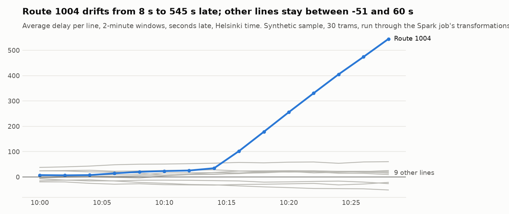
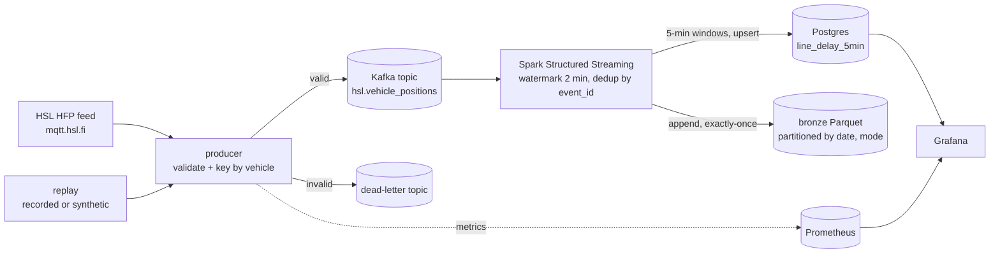

# Helsinki Transit Real-Time Delay Pipeline


A streaming data pipeline that shows which Helsinki tram and bus lines are running late, updated
every 30 seconds: **HSL MQTT feed → Kafka (Redpanda) → Spark Structured Streaming → Parquet +
Postgres → Grafana**, with Prometheus metrics. It is built to stay correct when things go wrong:
duplicates, late events, bad messages and crashes.

**What this project shows**

- Streaming fundamentals done properly: event time, watermarks, de-duplication, dead-letter queue.
- **Effectively exactly-once results**, proven by tests: a crash and restart gives the same numbers
  as an uninterrupted run, and a replayed batch never double counts in Postgres.
- Operations: Grafana dashboards for delays *and* pipeline health, Prometheus metrics for message
  rate, dead-letter share and event lag, one-command local stack.



## Problem

HSL publishes the position of every vehicle about once per second. Operations staff want to see,
in near real time, where delays start and which lines are affected, without double counting when
the pipeline restarts and without bad GPS data skewing the numbers.

## Architecture



Step-by-step explanation of the code: **[docs/how-it-works.md](docs/how-it-works.md)**.
Why each choice was made: **[docs/decisions.md](docs/decisions.md)**.

## Quick start

```bash
make up        # offline: synthetic sample replayed at 10x speed
make up-live   # real HSL feed (trams by default; set MQTT_TOPIC for all modes)
make crash-test   # kill Spark for 60 s, restart it, watch it catch up correctly
```

- Grafana: http://localhost:3000 (admin / admin) → dashboard **HSL real-time delays**
- Redpanda Console: http://localhost:8080 → topics, consumer lag, dead-letter messages
- Prometheus: http://localhost:9090 → `hsl_messages_total`, `hsl_event_lag_seconds`

Run the tests (needs Java 17+ for local Spark):

```bash
python -m venv .venv && source .venv/bin/activate
make install && make test
python -m hsl_pipeline.report      # regenerate docs/results.md and the chart
```

## Results

Synthetic sample (30 minutes, 30 trams), run through the same validation and Spark
transformations as production:

| Step | Count |
| --- | --- |
| Raw MQTT messages | 10,971 |
| Sent to dead-letter topic (bad JSON, GPS errors, missing fields) | 67 |
| Valid events | 10,904 |
| Duplicate deliveries removed | 104 |
| Events counted in delay windows | 10,800 |

Every valid event is either removed as a duplicate or counted exactly once
(10,904 − 104 = 10,800). Validation and routing run at about 34,000 messages/s on one core with
metrics enabled. Live-feed numbers (events per second, end-to-end latency) will be added after a
recorded run against mqtt.hsl.fi.

## Design decisions (summary)

- **Validate at the edge** and send bad messages to a dead-letter topic with the reason.
- **Key by vehicle** to keep each vehicle's events in order.
- **Event time + 2-minute watermark**; `dropDuplicatesWithinWatermark` on `event_id`.
- **Exactly-once results** = Kafka offsets in the checkpoint + exactly-once Parquet sink +
  idempotent Postgres upsert.
- **Honest watermark semantics:** Spark guarantees that data within the delay is counted, not that
  later data is dropped. Every event is kept in bronze.
- **Same code in tests and production:** the file source and Kafka both give a `value` column.

Full reasoning, costs and alternatives: [docs/decisions.md](docs/decisions.md).

## Project layout

```
src/hsl_pipeline/
  schema.py         HFP parsing and validation (pydantic)
  router.py         valid -> main topic, invalid -> dead-letter; idempotent Kafka producer
  metrics.py        Prometheus counters, lag histogram, freshness gauge
  producer.py       live MQTT -> Kafka, optional recording for replay
  replay.py         replay a recording at N x speed
  sample.py         synthetic HFP-like data with realistic mess
  streaming_job.py  Spark: parse, dedup, window, bronze sink, Postgres upsert sink
  report.py         results table and chart from the sample
jobs/run_streaming.py   spark-submit entry point
sql/init.sql            serving and health tables
grafana/, prometheus.yml dashboards and scraping
docs/                   how-it-works, decisions, results, chart
```

## Testing and quality

- **20 tests**: validation (good and bad messages), dead-letter routing, the idempotent Kafka
  producer with a full-buffer retry, replay, Prometheus metrics, and Spark streaming tests for
  de-duplication, late events inside the watermark, the traffic jam showing up, UTC timestamps,
  **restart from checkpoint = same result**, and the Postgres upsert against a real database.
- **CI**: ruff lint and format, mypy, pytest with a Postgres service and an 80% coverage gate,
  Docker image builds.
- `pre-commit install` runs the same checks locally.

## What I'd do next

- Join with the GTFS timetable to compute delays per stop.
- Delta Lake or Iceberg for the bronze table (compaction, time travel).
- Alert rules in Grafana on dead-letter share and data freshness.
- Rewrite `delay_windows` in PyFlink and compare latency with Spark.

Data: HSL high-frequency positioning via [Digitransit](https://digitransit.fi/en/developers/),
© Helsinki Region Transport, CC BY 4.0. Check the current access terms before running live.
